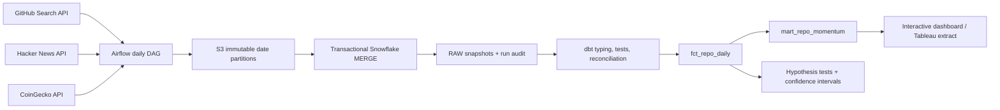

# Open-Source Ecosystem Intelligence Platform

An end-to-end analytics engineering project that converts live GitHub repository telemetry into reliable daily snapshots, tested analytical models, statistical evidence, and a decision-support ranking for technology evaluation teams.

The platform answers a practical question: **which open-source data engineering projects are both important and actively maintained enough to warrant deeper technical evaluation?** It combines Airflow, Python, S3, Snowflake, dbt, SQL, statistics, and an interactive dashboard. CoinGecko remains a separately modeled source, while Hacker News provides a correctly named supplemental community feed; GitHub is the coherent analytical domain.

## Verified results

The committed evidence run uses **50 live public GitHub repositories** collected on **November 21, 2026**.

| Evidence | Result |
| --- | ---: |
| Idempotency acceptance test | **3 replays → 50 / 50 / 50 rows** |
| Duplicate repository/date keys | **0** |
| Local data-quality checks | **8 / 8 passed** |
| Automated Python tests | **9 passed** |
| High-star repositories pushed within 30 days | **84.6%** (11/13) |
| Other repositories pushed within 30 days | **40.5%** (15/37) |
| Absolute maintenance-rate difference | **+44.1 percentage points** |
| Fisher exact test | **odds ratio 8.07, p=0.0092** |

Top-quartile starred repositories in this selected ecosystem were substantially more likely to have a recent commit. The association is observational, not causal: repository age, organization resources, and the GitHub search selection can confound it. Wilson 95% confidence intervals and complete assumptions are in [`docs/ANALYTICAL_FINDINGS.md`](docs/ANALYTICAL_FINDINGS.md).

The proposed star-growth/future-fork-growth hypothesis is intentionally marked **insufficient history** until at least 14 daily snapshots exist. The project does not fabricate historical measurements to force a result.

## Architecture



### Declared grain and stable keys

- Raw and fact grain: one `repo_id` per `snapshot_date`.
- Stable snapshot key: SHA-256 of source/table, repository ID, and snapshot date.
- Replays use Snowflake `MERGE`; a matching key updates the batch metadata/payload instead of inserting a duplicate.
- All records retain `run_id`, `source_file`, `ingested_at`, and source timestamps.
- The four-source warehouse load commits atomically and rolls back on any failure.

## Decision-support data products

| Model | Purpose |
| --- | --- |
| `stg_github_repos` | Typed repository identity, popularity, issue, timestamp, and lineage fields |
| `stg_hackernews_posts` | Correctly named typed community stories (replaces misleading Reddit naming) |
| `fct_repo_daily` | One repository/day with maintenance recency, age, issue burden, and fork/star ratio |
| `mart_repo_momentum` | Current evaluation ranking, growth measures, maintenance risk, and evidence readiness |
| `fct_ingestion_counts` | Operational source volume reconciliation |

The ranking combines observable activity recency, star percentile, and fork percentile. It is a transparent triage aid—not a claim of repository quality.

## Reliability and security upgrades

- Daily Airflow schedule at 06:00 UTC, three retries, bounded execution time, and one active run.
- GitHub API extraction with retryable transient failures, stable run metadata, and schema versioning.
- Credential-free Snowflake external stage using `STORAGE_INTEGRATION`; no AWS secret is interpolated into SQL.
- Transactional, replay-safe `MERGE` for every raw source plus `PIPELINE_RUN_AUDIT`.
- Eight dbt schema tests, three singular business-rule/reconciliation tests, and source freshness thresholds.
- CI linting, mocked transformation/idempotency tests, loader security tests, and committed-evidence release gates.
- Visible failures: malformed timestamps, negative metrics, key duplication, reconciliation gaps, and stale sources fail checks instead of being silently skipped.

## Statistical analysis

### Hypothesis A — popularity and recent maintenance

`H₁`: top-quartile starred repositories have a higher proportion of pushes within 30 days than the remaining repositories.

The analysis reports group sample sizes, rates, Wilson confidence intervals, the absolute effect size, Fisher's exact odds ratio and p-value, and an explicit non-causal limitation statement. The raw and curated records are committed so the result can be recalculated independently.

### Hypothesis B — star growth and subsequent fork growth

This requires non-overlapping longitudinal windows. The pipeline calculates daily star/fork deltas, counts repository history, and exposes `growth_evidence_status`. Formal testing remains blocked until 14 snapshots exist. This is a deliberate analytical guardrail.

## Run the verified local path

The local path requires no AWS or Snowflake account. It collects a bounded public GitHub snapshot, replays the batch three times, validates it, creates Parquet/CSV analytics products, runs both hypothesis gates, and builds the dashboard.

```bash
python3 -m pip install -r requirements-dev.txt
make verify
```

Key artifacts:

- [`outputs/reports/latest_run_manifest.json`](outputs/reports/latest_run_manifest.json) — replay counts, DQ status, and analytical result
- [`outputs/reports/data_quality_results.csv`](outputs/reports/data_quality_results.csv) — rule-by-rule validation evidence
- [`outputs/reports/hypothesis_results.json`](outputs/reports/hypothesis_results.json) — effect sizes, intervals, tests, and readiness
- [`outputs/analytics/mart_repo_momentum.csv`](outputs/analytics/mart_repo_momentum.csv) — ranked decision-support mart
- [`outputs/analytics/tableau_repo_momentum_extract.csv`](outputs/analytics/tableau_repo_momentum_extract.csv) — Tableau-ready extract
- [Interactive ecosystem dashboard](outputs/dashboard/ecosystem_intelligence_dashboard.html)

The production extractor uses the GitHub REST API and `GITHUB_TOKEN`. The bounded evidence builder uses public GitHub pages only when unauthenticated API quota is unavailable, preserving a credential-free reviewer experience.

## Run the cloud pipeline

1. Configure `.env` from `.env.example` and create `dbt_project/profiles.yml` from the example.
2. Create the Snowflake storage integration and stage using [`docs/SNOWFLAKE_SETUP.sql`](docs/SNOWFLAKE_SETUP.sql).
3. Start Airflow: `docker compose up -d --build`.
4. Enable `dev_ecosystem_elt`; it is scheduled daily and can also be triggered manually.
5. Run `dbt source freshness`, `dbt build`, and query `ANALYTICS.MART_REPO_MOMENTUM`.

## Repository map

```text
├── analytics/                         # normalization, DQ, marts, hypotheses, public evidence collector
├── dags/
│   ├── ecosystem_elt_dag.py           # scheduled/retried orchestration
│   └── extractors/                    # GitHub, Hacker News, CoinGecko, S3
├── dbt_project/
│   ├── models/staging/                # typed, lineage-preserving source models
│   ├── models/marts/                  # daily fact and evaluation mart
│   └── tests/                         # business rules and reconciliation
├── scripts/load_to_snowflake.py       # atomic integration-backed MERGE loader
├── scripts/build_portfolio_evidence.py# credential-free reproducible analytical evidence
├── tests/                              # clean/corrupt fixtures, replay, security, statistics
├── outputs/                            # committed recruiter-verifiable evidence
└── docs/                               # architecture, findings, metric dictionary, operations
```

## Defensible resume bullets

- Engineered a daily analytics pipeline across Airflow, S3, Snowflake, and dbt with transactional `MERGE` loading; demonstrated replay safety across three identical runs with zero duplicate repository/date keys and 8/8 local quality checks passing.
- Built typed repository-day facts, a decision-support ranking, and reproducible hypothesis analysis over 50 live open-source projects; found a 44.1-point difference in recent-maintenance rates for top-quartile starred repositories (Fisher p=0.0092), with confidence intervals and non-causal limitations reported.

These bullets describe committed, inspectable evidence. They do not claim unmeasured revenue, time savings, or causal impact.
