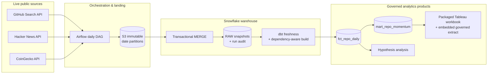
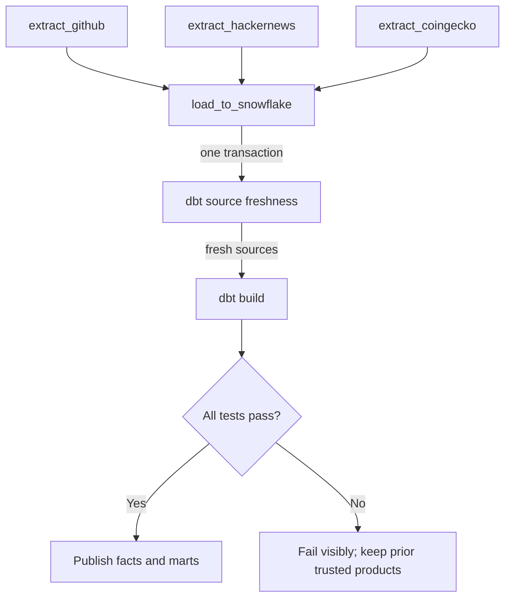
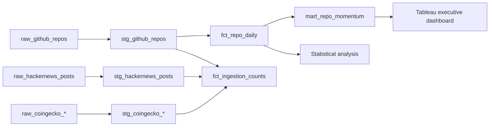
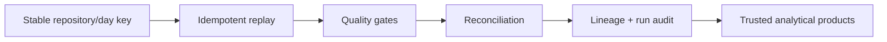

<div align="center">

# Open-Source Ecosystem Intelligence Platform

### From live GitHub telemetry to reliable technology-evaluation decisions

[](https://github.com/tmushd/dev-ecosystem-pipeline/actions/workflows/ci.yml)


**Airflow · Python · AWS S3 · Snowflake · dbt · SQL · Statistical Analysis · Tableau**

[Download the Tableau dashboard](outputs/dashboard/Open_Source_Ecosystem_Intelligence.twbx) ·
[Read the findings](docs/ANALYTICAL_FINDINGS.md) ·
[Inspect the run evidence](outputs/reports/latest_run_manifest.json) ·
[View the decision mart](outputs/analytics/mart_repo_momentum.csv)

</div>

---

## The 30-second portfolio brief

| | |
| --- | --- |
| **Business question** | Which open-source data-engineering projects are both important and actively maintained enough to justify deeper technical evaluation? |
| **What I built** | A daily analytics platform that collects public ecosystem signals, enforces a repository-day grain, publishes tested decision marts, evaluates hypotheses, and creates a stakeholder-facing dashboard. |
| **Verified dataset** | 50 live GitHub repositories collected November 21, 2026. |
| **Key finding** | Top-quartile starred repositories had a **44.1 percentage-point higher** recent-maintenance rate than the remaining sample. |
| **Reliability evidence** | Three identical local replays produced **50 → 50 → 50 rows**, zero duplicate keys, and **10/10 quality checks passed**. |
| **Why it matters** | The project demonstrates the full analyst workflow: trustworthy data preparation, SQL modeling, validation, statistical reasoning, visualization, and a decision recommendation. |

> **Headline insight:** 84.6% of top-quartile starred repositories had a commit within 30 days, compared with 40.5% of the remaining repositories—an absolute difference of **44.1 points** (Fisher odds ratio **8.07**, `p = 0.0092`).

This is an observational result from a popularity-sorted search sample, not a causal claim or a representative estimate of all open-source projects.

## Verified outcomes

| Engineering and analytical evidence | Result |
| --- | ---: |
| Live repositories in the committed snapshot | **50** |
| Replay acceptance test | **50 / 50 / 50 rows** |
| Duplicate `repo_id + snapshot_date` keys | **0** |
| Local data-quality gates | **10 / 10 passed** |
| Python unit and contract tests | **13 passed** |
| Declared dbt data tests | **22** |
| High-star repositories active within 30 days | **84.6%** (11/13) |
| Remaining repositories active within 30 days | **40.5%** (15/37) |
| Absolute rate difference | **+44.1 percentage points** |
| Fisher exact result | **OR 8.07 · p=0.0092** |
| Issue-count collection coverage | **50% observed; 50% preserved as null** |

### Sensitivity check

The popularity/activity association remains positive across four precomputed maintenance windows:

| Active within | High-star rate | Other rate | Difference | Fisher p-value |
| ---: | ---: | ---: | ---: | ---: |
| 14 days | 84.6% | 37.8% | +46.8 pts | 0.0083 |
| 30 days | 84.6% | 40.5% | +44.1 pts | 0.0092 |
| 60 days | 92.3% | 45.9% | +46.4 pts | 0.0037 |
| 90 days | 92.3% | 54.1% | +38.3 pts | 0.0180 |

The full analysis also reports Wilson confidence intervals and activity rates by repository-age quartile in [the analytical findings](docs/ANALYTICAL_FINDINGS.md).

## Architecture



### Orchestration and failure boundary



Airflow runs daily at 06:00 UTC with three retries, a 45-minute execution limit, and one active run. `dbt source freshness` precedes `dbt build`, so models and tests execute in dependency order even on a newly provisioned warehouse.

## Data model and lineage



| Data product | Grain | Decision value |
| --- | --- | --- |
| `stg_github_repos` | Repository × snapshot date | Typed popularity, activity, issue, timestamp, and lineage fields |
| `stg_hackernews_posts` | Story × snapshot date | Correctly named supplemental discussion signals |
| `fct_repo_daily` | Repository × snapshot date | Maintenance recency, age, issue burden, and fork/star measures |
| `mart_repo_momentum` | Latest repository snapshot | Evaluation score, maintenance risk, growth measures, and evidence readiness |
| `fct_ingestion_counts` | Source | Operational reconciliation across landed sources |

The evaluation score combines activity recency, star percentile, and fork percentile. It is a transparent triage policy—not a probability of software quality.

## How the platform supports a decision

| Signal | Interpretation | Recommended action |
| --- | --- | --- |
| High evaluation score + `ACTIVE` | Popular and currently maintained | Prioritize for technical evaluation |
| High popularity + `WATCH` | Important, but maintenance may be slowing | Review releases, issue response, and roadmap before adoption |
| `HIGH` maintenance risk | No recent default-branch activity | Require manual due diligence or identify alternatives |
| `COLLECTING_HISTORY` | Insufficient longitudinal evidence | Do not describe current popularity as momentum |
| Missing issue count | Collection unavailable—not a true zero | Exclude issue-burden comparisons until observed |

## Data reliability by design



- **Stable grain:** one `repo_id` per `snapshot_date` throughout the analytical path.
- **Replay safety:** Snowflake SQL uses deterministic keys and `MERGE`; the credential-free local acceptance path verifies three identical replays.
- **Atomic warehouse logic:** all source merges and audit writes commit together or roll back together.
- **Secure staging:** Snowflake uses `STORAGE_INTEGRATION`; AWS secrets are not interpolated into SQL.
- **Visible invalid data:** negative counts, malformed timestamps, duplicate keys, stale sources, and reconciliation gaps fail tests.
- **Missing ≠ zero:** unavailable issue counts remain null with an explicit collection status. In the evidence snapshot, 25 counts were observed and 25 remained null.
- **Traceability:** records retain `run_id`, `source_file`, `ingested_at`, source timestamps, schema version, and a source SHA-256 fingerprint.

## Statistical reasoning—not just a dashboard

### Hypothesis A: popularity and recent maintenance

`H₁`: Top-quartile starred repositories have a higher proportion of pushes within 30 days than the remaining selected repositories.

The analysis reports sample sizes, group rates, Wilson 95% confidence intervals, absolute effect size, Fisher's exact odds ratio and p-value, activity-window sensitivity, age-group context, and non-causal limitations.

### Hypothesis B: star growth and subsequent fork growth

This test requires non-overlapping longitudinal windows. The platform calculates daily deltas and exposes `growth_evidence_status`, but the test is deliberately marked **INSUFFICIENT_HISTORY** until at least 14 daily snapshots exist. No synthetic history is created to force an attractive conclusion.

## Dashboard and stakeholder outputs

The repository contains a self-contained [**Tableau packaged workbook**](outputs/dashboard/Open_Source_Ecosystem_Intelligence.twbx). Its embedded governed extract means a reviewer can open it without AWS, Snowflake, or local-path setup.

1. **Repository Landscape** — stars versus days since last push, with fork count by size and maintenance risk by color.
2. **Evaluation Ranking** — repository-level evaluation scores for technical-evaluation triage.
3. **Maintenance Risk** — portfolio composition across `ACTIVE`, `WATCH`, and `HIGH` risk tiers.
4. **Executive Overview** — a 1400 × 900 dashboard composing all three decision views.

The editable [workbook source](tableau/Open_Source_Ecosystem_Intelligence.twb), packaged workbook, and [Tableau data extract](outputs/analytics/tableau_repo_momentum_extract.csv) are rebuilt together by the evidence pipeline. Automated gates validate the package contents, XML, data connection, worksheets, dashboard, and ZIP integrity.

| Reviewer artifact | What it proves |
| --- | --- |
| [Tableau packaged workbook](outputs/dashboard/Open_Source_Ecosystem_Intelligence.twbx) | Self-contained stakeholder-facing decision dashboard |
| [Tableau workbook source](tableau/Open_Source_Ecosystem_Intelligence.twb) | Reviewable and reproducible BI implementation |
| [Decision mart](outputs/analytics/mart_repo_momentum.csv) | Ranked repository-level analytical output |
| [Hypothesis results](outputs/reports/hypothesis_results.json) | Effect sizes, uncertainty, sensitivity, and readiness gate |
| [Data-quality results](outputs/reports/data_quality_results.csv) | Rule-by-rule validation evidence |
| [Latest run manifest](outputs/reports/latest_run_manifest.json) | Source fingerprint, duration, counts, replays, and outcomes |
| [Metric dictionary](docs/METRIC_DICTIONARY.md) | Business definitions and limitations |
| [Operations runbook](docs/OPERATIONS_RUNBOOK.md) | Failure, recovery, replay, and backfill procedures |

## Evidence boundary

This table makes the project's proof level explicit:

| Capability | Status | Evidence |
| --- | --- | --- |
| Live public GitHub collection | **Verified locally** | Committed raw snapshot and SHA-256 manifest |
| Three replay idempotency test | **Verified locally** | 50/50/50 counts and zero duplicate keys |
| Python contracts and analytics | **Verified in CI** | 13 automated tests and release gates |
| dbt project structure | **Parsed and tested statically** | 7 models and 22 declared data tests |
| Snowflake transactional merge | **Implemented and unit-tested** | SQL construction/security tests; live replay proof still pending |
| Native Tableau workbook | **Implemented and package-validated** | `.twb`, embedded CSV, three worksheets, and executive `.twbx` dashboard |

## Technology choices

| Layer | Technology | Why it is used |
| --- | --- | --- |
| Source collection | Python, GitHub REST, Hacker News, CoinGecko | Real public data and explicit failure handling |
| Orchestration | Apache Airflow | Scheduling, parallel extraction, retries, dependency control |
| Raw landing | AWS S3 | Immutable date partitions and replayable source evidence |
| Warehouse | Snowflake | Transactional merge, semi-structured ingestion, governed analytics |
| Transformation | dbt + SQL | Typed models, lineage, freshness, tests, incremental facts |
| Analysis | pandas + SciPy | Reproducible effect sizes, intervals, and hypothesis tests |
| Visualization | Tableau packaged workbook | Recruiter-ready executive BI artifact with an embedded governed extract |
| Delivery | GitHub Actions | Lint, tests, dbt parse, and evidence release gates |

## Reproduce the verified evidence

The reviewer path requires no AWS or Snowflake credentials:

```bash
git clone https://github.com/tmushd/dev-ecosystem-pipeline.git
cd dev-ecosystem-pipeline
python3 -m pip install -r requirements-dev.txt
make verify
```

`make verify` runs Python tests, linting, dbt parsing, a bounded live GitHub evidence build, and release assertions.

<details>
<summary><strong>Run the cloud pipeline</strong></summary>

1. Configure `.env` from `.env.example`.
2. Create `dbt_project/profiles.yml` from the example.
3. Provision the least-privilege Snowflake role and storage integration using [`docs/SNOWFLAKE_SETUP.sql`](docs/SNOWFLAKE_SETUP.sql).
4. Start Airflow with `docker compose up -d --build`.
5. Enable or manually trigger `dev_ecosystem_elt`.
6. Query `ANALYTICS.MART_REPO_MOMENTUM` after `dbt build` succeeds.

</details>

## Repository guide

```text
├── analytics/                         # normalization, DQ, marts, hypotheses, public evidence
├── dags/
│   ├── ecosystem_elt_dag.py           # scheduled orchestration and dependency order
│   └── extractors/                    # GitHub, Hacker News, CoinGecko, S3
├── dbt_project/
│   ├── models/staging/                # typed, lineage-preserving source models
│   ├── models/marts/                  # repository-day fact and evaluation mart
│   └── tests/                         # business rules and count reconciliation
├── scripts/load_to_snowflake.py       # atomic integration-backed MERGE loader
├── scripts/build_portfolio_evidence.py# credential-free reproducible evidence
├── tableau/                            # editable Tableau workbook source and usage guide
├── tests/                              # clean/corrupt fixtures, replay, DAG, security, statistics
├── outputs/                            # committed recruiter-verifiable results
└── docs/                               # findings, architecture, metrics, and operations
```

## Resume-ready impact

- Engineered a daily analytics platform across Airflow, S3, Snowflake, and dbt with transactional `MERGE` loading, dependency-aware builds, 22 warehouse tests, and replay-safe repository/day modeling; verified three identical local replays with zero duplicate keys and 10/10 quality gates passing.
- Analyzed 50 live open-source repositories using effect sizes, Wilson intervals, Fisher's exact testing, activity-window sensitivity, and age context; identified a **44.1-point difference** in recent-maintenance rates for top-quartile starred projects (`p=0.0092`) and translated the result into a technical-evaluation workflow.

These claims are tied to committed artifacts and deliberately exclude unmeasured revenue, time savings, causal impact, live Snowflake replay proof, or a hosted Tableau Public deployment. The packaged Tableau workbook is generated and structurally validated in CI; final visual rendering requires Tableau Desktop or Tableau Public.
